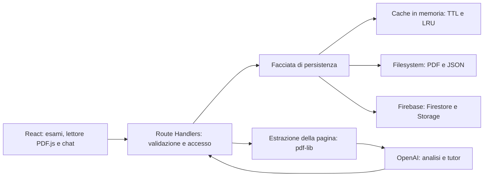

# Margine

**Workspace di studio con tutor AI per organizzare PDF, comprendere le slide e pianificare la preparazione degli esami.**

Applicazione full stack sviluppata con **Next.js, React e TypeScript**, con persistenza locale oppure **Firebase**, analisi concorrente dei materiali e una suite di test unitari, di integrazione ed end-to-end.

Il login presenta **Tony**, la mascotte animata, su uno sfondo a puntini, con accesso Google e animazioni rispettose delle preferenze di movimento. L'analisi prosegue durante la navigazione nell'app: un indicatore flottante mostra avanzamento e stato, permette di interromperla e si può nascondere o riaprire. La scheda del browser deve restare aperta.

Tony accompagna anche il nome Studio nella sidebar. La home saluta l'utente con il nome Google e alterna frasi dedicate a esami, sfide e scoperte, mantenendo stabile lo spazio del titolo.

Il saluto resta su una riga adattando la dimensione del testo. Il dettaglio dei file in analisi parte chiuso; aprirlo non allunga il componente di caricamento. Il riepilogo flottante mostra subito le pagine segnate come lette oggi, un cronometro e i progressi del PDF aperto. Nascondere il riepilogo non arresta il timer. Il cronometro attivo viene conservato nel browser; fermandolo, la sessione con durata e pagine per PDF viene salvata nell'account Firebase oppure nell'archivio locale. Le scritture dello storico vengono accodate e possono essere ritentate in caso di errore.

La home mostra una griglia degli ultimi 365 giorni con intensità verde proporzionale alle pagine lette. Selezionare un giorno apre **Sessioni di studio**, accessibile anche dalla sidebar, con filtro per data e statistiche. Dal menu di un PDF si può registrare un intervallo già letto, indicando facoltativamente un periodo passato per distribuirne le pagine nel calendario. Ripetere lo stesso import non duplica le pagine dello stesso giorno.

L'apertura passa immediatamente al lettore e mostra **Tony del bar** con frasi da barista mentre il PDF arriva. Uscire durante il caricamento annulla la richiesta senza riaprire il documento in seguito. Anche i salvataggi già avviati continuano tornando ai materiali.

Le richieste della chat continuano durante la navigazione interna: una notifica segnala la risposta pronta e riapre PDF e pagina corrispondenti. La scheda deve restare aperta; la conversazione completata viene salvata con la pagina.

Dal pulsante **Quiz** del lettore si possono generare da 1 a 30 domande a scelta multipla, aperte, vero/falso o miste, scegliendo difficoltà e argomenti. Gli argomenti suggeriti provengono dalle analisi salvate; si possono indicare anche manualmente. Il generatore usa l'intero PDF, incluse le pagine non analizzate. La stessa funzione è disponibile in chat, per esempio: «Crea 10 domande, 3 aperte e 7 chiuse, su entropia e microstati». Le schede quiz vengono salvate nella conversazione; risposte e correzione dell'esercizio restano nel browser. Le domande chiuse hanno un punteggio automatico; quelle aperte mostrano una risposta di riferimento per il confronto. La generazione segue la [documentazione ufficiale OpenAI sulle risposte strutturate](https://developers.openai.com/api/docs/guides/structured-outputs?api-mode=responses).

Le sessioni con timer supportano selezione multipla e azioni dal tasto destro: eliminazione e aggregazione con conferma. I gruppi conservano il periodo, uniscono le pagine distinte e contano una sola volta i tempi sovrapposti; il calendario delle letture resta indipendente. Le cartelle e la sidebar riprendono il linguaggio visivo di ArchAIve, con accenti principali blu. Le schede mostrano nome del corso, data, CFU facoltativi, giorni rimanenti e carico giornaliero; le parole significative del nome hanno l'iniziale maiuscola, mentre articoli, congiunzioni e preposizioni restano minuscoli. Le impostazioni raccolgono pianificazione, colore, CFU, archiviazione reversibile ed eliminazione confermata dei materiali. La home permette di cercare gli esami ignorando accenti e maiuscole e ordinarli per scadenza, nome o creazione. Home e pagina del corso condividono larghezza e spazi laterali; il fondo combina puntini e riquadri azzurri sfumati ispirati alla reference fornita.

La mascotte riutilizza il renderer Onee distribuito con licenza **AGPL-3.0-only**; attribuzione e riferimenti in [THIRD_PARTY_NOTICES.md](THIRD_PARTY_NOTICES.md).

Il progetto esplora problemi concreti di software engineering: gestione della concorrenza, consistenza dei salvataggi, invalidazione della cache, integrazione con un servizio AI e progettazione di un'interfaccia di lettura accessibile.

> **Sviluppo assistito dall'AI:** Margine è stato realizzato attraverso un approccio di **vibe coding**, utilizzando assistenti generativi per implementazione, refactoring e sviluppo dei test. Requisiti, priorità del prodotto e criteri di accettazione sono stati definiti dall'autore. Il codice prodotto con l'AI viene verificato attraverso controlli di tipo, test automatici e verifiche dell'interfaccia. La responsabilità delle scelte tecniche e del risultato rimane dell'autore.

## Il problema

Preparare un esame richiede spesso di passare continuamente tra slide, appunti, spiegazioni e calendario. Margine riunisce queste attività in uno spazio organizzato per materia, mantenendo il contesto della pagina che si sta studiando.

Le spiegazioni generate e i progressi di lettura sono dati distinti: una pagina analizzata dall'AI non viene considerata automaticamente studiata.

## Funzionalità

- **Organizzazione per esame:** cartelle, caricamento multiplo di PDF, rinomina, ordinamento dei materiali e collegamenti diretti a esami e documenti.
- **Lettore PDF con tutor affiancato:** zoom, schermo intero, navigazione da tastiera e divisore trascinabile per ridimensionare, chiudere e riaprire la chat, anche su mobile.
- **Spiegazioni contestuali:** analisi della pagina con concetti chiave, esempi, formule, glossario inglese-italiano e richieste di approfondimento.
- **Chat per pagina:** conversazioni persistenti, contesto della slide oppure dell'intero PDF aperto, risposte Markdown, tabelle, formule LaTeX e codice evidenziato con copia negli appunti.
- **Analisi di più materiali:** tutti i file con pagine mancanti partono automaticamente in parallelo, anche oltre sei, mantenendo sequenziali le pagine di ciascun file. Puoi avviare contemporaneamente più esami, con avanzamento e arresto separati. La ripresa riutilizza le spiegazioni salvate e i PDF restano apribili durante l'analisi.
- **Tracciamento dello studio:** appunti con salvataggio automatico, pagine lette tramite pulsante o barra spaziatrice, bordo verde pastello e documento considerato letto dal 95% delle pagine. Badge separati indicano lo stato dell'analisi AI.
- **Pianificazione:** data dell'esame, ritmo di studio, stima del carico giornaliero, giorni di pausa ricorrenti e singole date escluse, riutilizzabili da un altro esame.
- **Profilo di studio:** percorso universitario o ambito disciplinare utilizzato per contestualizzare le nuove spiegazioni.

## Stack tecnologico

| Area | Tecnologie |
| --- | --- |
| Frontend | Next.js 16, React 19, TypeScript |
| UI | Componenti locali basati su primitive Radix UI, CSS con design token, Lucide, React DayPicker |
| Backend | Node.js, Next.js Route Handlers, validazione con Zod |
| PDF | PDF.js per il rendering nel browser; pdf-lib per validazione ed estrazione delle pagine sul server |
| AI | OpenAI SDK e Responses API; output strutturati e validazione delle spiegazioni con Zod |
| Markdown | react-markdown, remark-gfm, remark-math, KaTeX e rehype-highlight |
| Persistenza locale | File JSON e PDF su filesystem; scritture serializzate e sostituzione atomica dei metadati |
| Persistenza cloud | Firebase Authentication con Google, Cloud Firestore, Cloud Storage e Firebase Admin SDK |
| Cache | Cache in memoria con TTL, politica LRU, limiti di dimensione e controllo delle revisioni |
| Test | Node.js test runner, tsx, Playwright con Chrome |

Le dipendenze effettive sono dichiarate in [package.json](package.json) e risolte in [package-lock.json](package-lock.json).

## Architettura



- [`components/`](components/) contiene interfaccia, composizione del lettore e orchestrazione delle interazioni.
- [`app/api/`](app/api/) espone gli endpoint e gestisce validazione, autenticazione ed errori.
- [`lib/`](lib/) contiene persistenza, cache, integrazione AI e funzioni di dominio, come pianificazione e ordinamento dei materiali.
- [`tests/`](tests/) verifica logica, persistenza e integrazioni simulate; [`e2e/`](e2e/) verifica i percorsi nel browser.

Il dettaglio delle decisioni, dei limiti e dei punti di estensione è in [Architettura e scelte progettuali](docs/ARCHITECTURE.md).

### Principi SOLID

L'applicazione dei principi è documentata rispetto al codice attuale, comprese le aree ancora da consolidare.

| Principio | Applicazione nel progetto |
| --- | --- |
| **Single Responsibility** | Pianificazione, ordinamento, cache e concorrenza sono separati in moduli dedicati. Il coordinamento in `Workspace` resta un candidato a ulteriori estrazioni. |
| **Open/Closed** | Cache generica e worker pool ricevono configurazione e callback. Aggiungere un nuovo backend di persistenza richiederebbe ancora modifiche alla selezione esplicita in `store.ts`. |
| **Liskov Substitution** | Le modalità locale e cloud espongono operazioni applicative analoghe; la loro sostituibilità completa richiede una futura interfaccia comune e test contrattuali per entrambi i backend. |
| **Interface Segregation** | Componenti e utility espongono props e funzioni mirate: disponibilità di studio, divisore del lettore, cache e ordinamento hanno contratti distinti. |
| **Dependency Inversion** | I Route Handlers accedono ai documenti attraverso la facciata di persistenza. L'iniezione dei provider storage e AI tramite interfacce esplicite è un passo successivo; gli import attuali sono ancora concreti. |

### Pattern e tecniche presenti

- **Facade e adattamento del provider:** `lib/store.ts` offre un punto di accesso ai documenti; `lib/cloud-store.ts` traduce le operazioni applicative in chiamate Firebase.
- **Cache-aside:** le letture riutilizzano snapshot compatibili con la revisione corrente, altrimenti caricano i dati dalla persistenza. La fonte persistente rimane autorevole.
- **Worker pool e coordinamento per esame:** `runParallelFiles` avvia un worker asincrono per ogni file da elaborare; `useCourseAnalysis` conserva lavori e controlli di arresto distinti per esame. In caso di arresto o errore attende le operazioni già avviate nel lavoro interessato prima di terminarlo.
- **Coda di scrittura per documento:** le modifiche locali dello stesso documento vengono serializzate; la sostituzione atomica evita di pubblicare un JSON scritto solo parzialmente.
- **Composizione e Context in React:** componenti specializzati compongono il workspace; i provider condividono stato del profilo e della sidebar.

## Avvio locale

Ambiente di riferimento: **Node.js 22.13+**, npm e PowerShell. Gli esempi usano `npm.cmd` per evitare restrizioni di esecuzione degli script PowerShell.

```powershell
npm.cmd ci
Copy-Item .env.example .env.local
npm.cmd run dev
```

Apri [127.0.0.1:3000](http://127.0.0.1:3000). Con `NEXT_PUBLIC_FIREBASE_ENABLED=false` puoi organizzare i PDF, leggere e salvare appunti senza configurare Firebase. Analisi e chat richiedono la chiave AI del server.

Le variabili sono elencate in [.env.example](.env.example):

| Variabile | Funzione |
| --- | --- |
| `OPENAI_API_KEY` | Credenziale server per analisi e chat |
| `OPENAI_MODEL` | Modello utilizzato dalle richieste AI |
| `NEXT_PUBLIC_FIREBASE_ENABLED` | Seleziona modalità locale (`false`) oppure autenticazione e persistenza Firebase (`true`) |
| `NEXT_PUBLIC_FIREBASE_*` | Configurazione dell'app Firebase nel browser |
| `FIREBASE_CLIENT_EMAIL`, `FIREBASE_PRIVATE_KEY` | Credenziali server alternative alle Application Default Credentials |
| `DATA_DIR` | Percorso dei dati locali; se assente viene usata la cartella `data/` |

Le chiavi AI e le credenziali private restano sul server. `.env.local` è escluso dal repository. Dopo una modifica alla configurazione riavvia il server; le variabili pubbliche Firebase richiedono anche una nuova build in produzione.

Per la modalità cloud consulta [Configurazione Firebase](FIREBASE.md).

## Test e verifica

```powershell
npm.cmd run typecheck
npm.cmd test
npm.cmd run build
npm.cmd run test:e2e
```

La suite comprende verifiche su salvataggi concorrenti, invalidazione della cache, isolamento delle copie, pianificazione, riutilizzo delle analisi, arresto dei worker e rendering Markdown. I test browser coprono caricamento, navigazione, chat, progressi di lettura, layout responsive, otto file concorrenti e analisi di più esami con arresto indipendente.

Le richieste AI nei test sono simulate: l'esecuzione della suite non richiede una chiave reale. I test end-to-end usano una build separata in `.next-e2e`, dati in `test-results/e2e-data` e Firebase disabilitato. La configurazione attuale richiede Chrome installato e usa `npm.cmd` per avviare il server di test su Windows.

La verifica contro un progetto Firebase reale e contro il servizio AI è un'attività distinta dai test automatici locali.

## Dati, sicurezza e limiti operativi

In modalità locale, PDF e JSON sono salvati sul computer che esegue il server. I comandi di avvio ascoltano su `127.0.0.1`; questa modalità è pensata per uso personale con una sola istanza sulla stessa cartella dati. Per un backup va conservata l'intera cartella `data/`.

In modalità Firebase, l'accesso passa da API autenticate e i dati sono organizzati sotto l'identificativo dell'utente. Le regole incluse negano l'accesso diretto dal browser a Firestore e Storage; il server usa Firebase Admin SDK.

Le richieste al tutor includono il contesto necessario alla funzione selezionata: pagina corrente oppure PDF completo, spiegazioni disponibili, appunti, cronologia recente e profilo di studio. Le richieste AI hanno `store: false`; il trattamento dei dati resta soggetto alle condizioni del fornitore. Le risposte generate possono contenere errori.

Limiti attuali:

- PDF e immagini **PNG/JPEG** fino a **500 MB** per file. Le immagini vengono convertite in PDF a una pagina. PDF fino a **1.000 pagine**; i documenti protetti da password devono essere sbloccati.
- L'analisi è orchestrata dal browser: occorre mantenere aperta la scheda. La ripresa riutilizza le pagine salvate; non è presente una coda di job durevole lato server.
- La concorrenza dei file è automatica, senza un tetto applicativo di sei: una richiesta di analisi per pagina può essere attiva per ogni file del lavoro. Browser, hosting e provider AI possono comunque accodare o limitare le richieste; non è presente un coordinamento globale distribuito tra schede, utenti o repliche del server.
- La cache server resta locale al processo: TTL di 5 minuti, fino a 16 PDF per 64 MiB e 128 documenti per 16 MiB. Il browser conserva fino a 100 MB in IndexedDB, separati per utente; revisioni ETag e aggiornamenti mirati riducono download e letture Firestore. Durate, invalidazione e limiti sono descritti in [Cache e prestazioni](docs/PERFORMANCE.md).
- Non sono implementati collaborazione in tempo reale, migrazione automatica dei dati locali o rate limiting applicativo distribuito.

## Evoluzioni previste

- Introdurre interfacce per storage e provider AI, con dependency injection e test contrattuali comuni.
- Spostare l'orchestrazione delle analisi in job persistenti per consentire la ripresa indipendente dalla sessione del browser.
- Aggiungere CI, test dei servizi cloud in un ambiente dedicato e misure di latenza e utilizzo delle risorse.
- Valutare una cache condivisa quando un deployment con più istanze ne dimostri la necessità.

L’analisi riprova automaticamente gli errori temporanei fino a 3 tentativi per pagina, con attese di 2 e 5 secondi. Le spiegazioni completate restano salvate. Errori di configurazione, quota esaurita e rifiuti espliciti non vengono ritentati.
